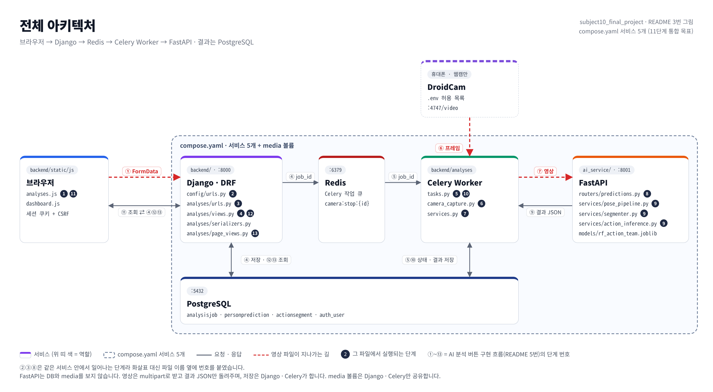
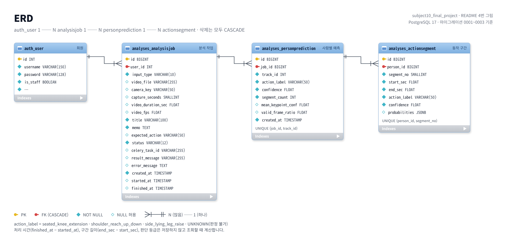
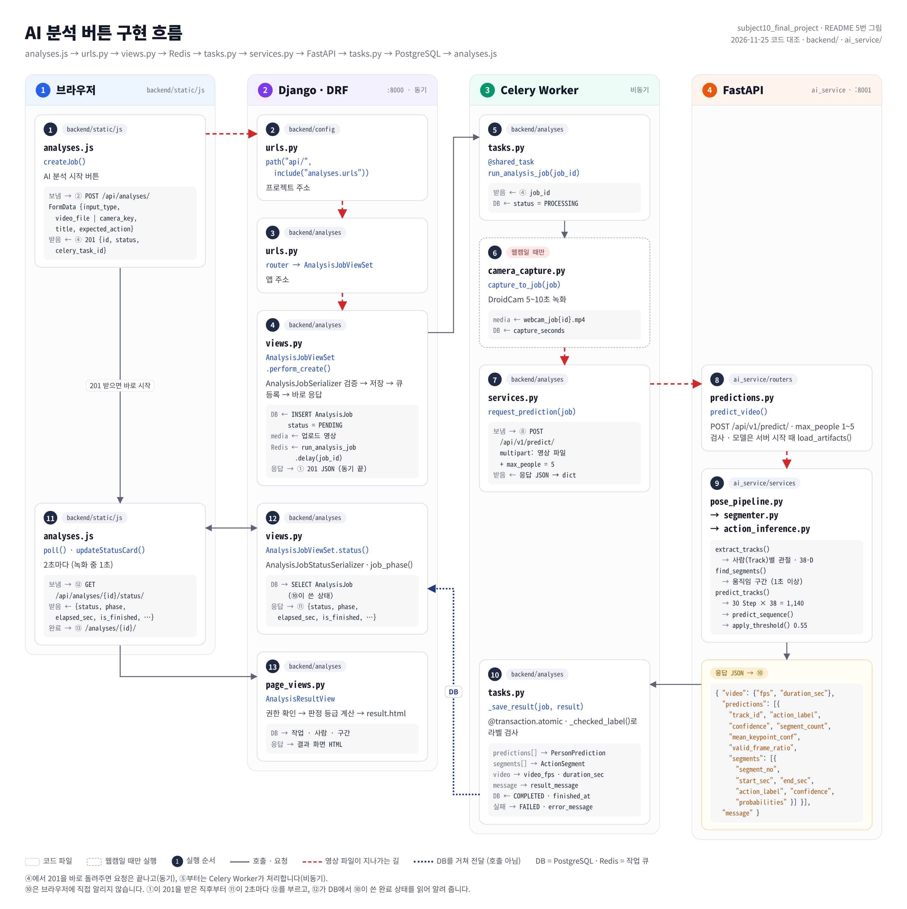
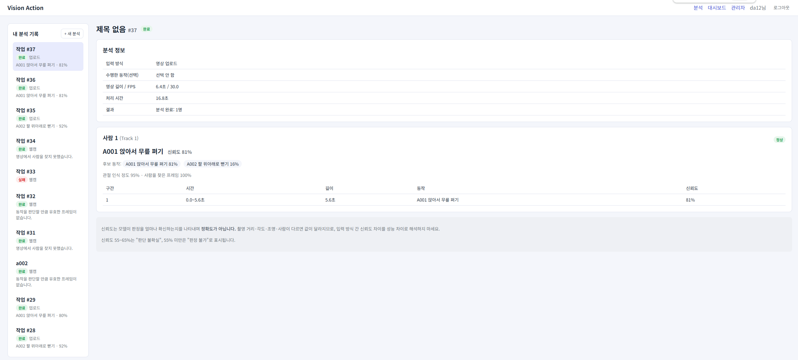
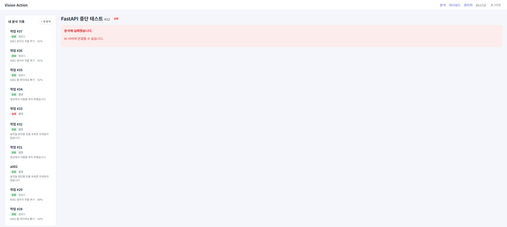
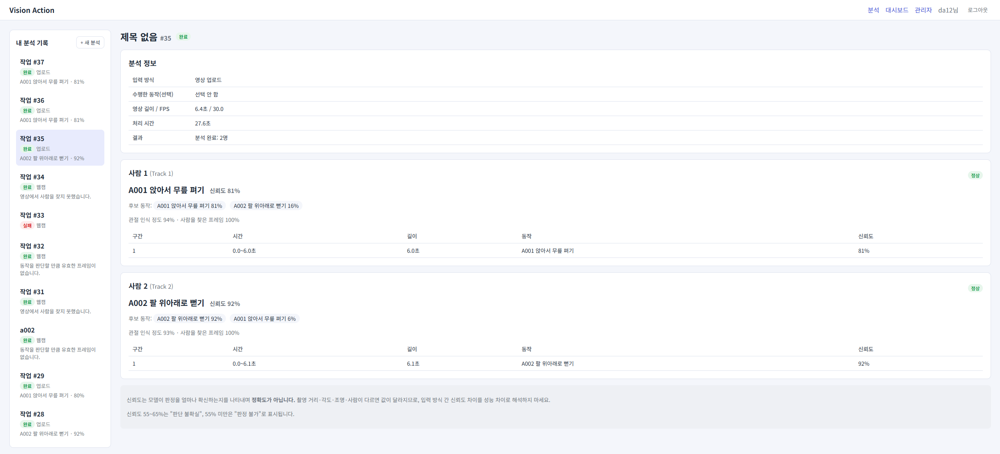
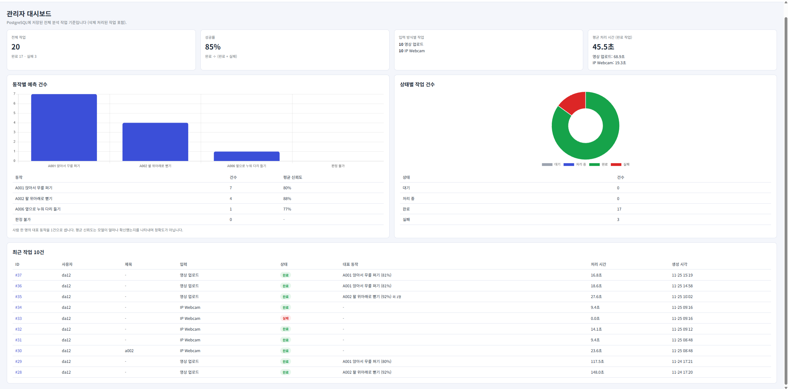

# Vision AI 동작 추론 플랫폼 (subject10_final_project)

## 1. 프로젝트 소개

재활·운동 동작 영상을 올리거나 휴대폰 카메라(IP Webcam)로 짧게 녹화하면, 영상 속 **사람마다** 어떤 동작을 했는지 AI가 판단해 보여주는 웹 서비스입니다.
교과10에서 팀이 학습한 Random Forest 동작 인식 모델을 그대로 가져와 Django·DRF(웹·API), Celery·Redis(비동기 처리), FastAPI(AI 추론), PostgreSQL(저장)로 연결했습니다.
분석은 버튼을 누른 즉시 작업 번호를 돌려주고 뒤에서 처리하며, 결과는 사람별 동작·신뢰도·동작 구간과 함께 "정상 / 판단 불확실 / 판정 불가"로 표시합니다.

| 항목 | 내용 |
|---|---|
| 인식 동작 | A001 앉아서 무릎 펴기 · A002 팔 위아래로 뻗기 · A006 옆으로 누워 다리 들기 (+ 기준 미만 `UNKNOWN`) |
| 입력 방식 | 영상 업로드(mp4·avi·mov·mkv) / IP Webcam(DroidCam, 시작·종료 버튼, 5~10초) |
| 사용자 기능 | 회원가입·로그인, 분석 요청, 상태 확인(대기·녹화 중·분석 중·완료·실패), 결과 조회, 본인 기록만 조회 |
| 관리자 기능 | Django Admin, `/dashboard/` (동작별·상태별 차트, 입력 방식별 처리 시간) |

## 2. 실행 방법

### 2-1. 준비물
- Docker Desktop (WSL2), Git
- 모델 파일 — 용량이 커서 Git에 올리지 않은 2개는 직접 받아 `ai_service/models/`에 넣습니다.

| 파일 | 위치 | 받는 곳 |
|---|---|---|
| `rf_action_team.joblib`, `rf_feature_columns.json`, `rf_training_info.json` | `ai_service/models/` | 저장소에 포함 |
| `pose_landmarker_heavy.task` (30MB) | `ai_service/models/` | https://storage.googleapis.com/mediapipe-models/pose_landmarker/pose_landmarker_heavy/float16/latest/pose_landmarker_heavy.task |
| `yolo11n-pose.pt` (6MB) | `ai_service/models/` | https://github.com/ultralytics/assets/releases/download/v8.3.0/yolo11n-pose.pt |

```bash
cd ai_service/models
wget https://storage.googleapis.com/mediapipe-models/pose_landmarker/pose_landmarker_heavy/float16/latest/pose_landmarker_heavy.task
wget https://github.com/ultralytics/assets/releases/download/v8.3.0/yolo11n-pose.pt
cd ../..
```

### 2-2. 환경변수
```bash
cp .env.example .env
```
`.env`에서 `POSTGRES_PASSWORD`, `DJANGO_SECRET_KEY`, `CAMERA_SOURCES`(예: `droidcam=http://휴대폰IP:4747/video`)를 바꿉니다.
컨테이너 안에서는 `compose.yaml`이 DB·Redis·FastAPI 주소를 서비스 이름(`postgres`·`redis`·`fastapi`)으로 덮어쓰므로 `.env`의 `localhost` 값은 그대로 둬도 됩니다.

### 2-3. 실행 (5개 서비스)
```bash
docker compose up -d --build
docker compose ps                     # 5개 모두 Up (healthy)
docker compose exec django python manage.py migrate
docker compose exec django python manage.py createsuperuser
```

| 주소 | 용도 |
|---|---|
| http://127.0.0.1:8000/ | 서비스 (회원가입·로그인 → 분석) |
| http://127.0.0.1:8000/dashboard/ | 관리자 대시보드 (staff 계정) |
| http://127.0.0.1:8000/admin/ | Django Admin |
| http://127.0.0.1:8001/docs | FastAPI Swagger (AI 서버 단독 확인) |

- 종료: `docker compose down` — **`-v`를 붙이면 DB가 지워지므로 쓰지 않습니다.**
- 로그: `docker compose logs django|celery|fastapi --tail 30`

## 3. 전체 아키텍처



| # | 위치 | 하는 일 |
|---|---|---|
| ① | 브라우저 → Django | `analyses.js`가 영상(웹캠은 카메라 이름)과 입력값을 FormData로 보냄 |
| ②③ | Django 안 · `config/urls.py` → `analyses/urls.py` | 주소를 `AnalysisJobViewSet`에 연결 |
| ④ | Django → PostgreSQL · Redis | 작업을 PENDING으로 저장, job_id를 큐에 넣고 201로 바로 응답 |
| ⑤ | Redis → Celery Worker | job_id를 꺼내 PROCESSING으로 바꾸고 처리 시작 |
| ⑥ | DroidCam → Celery Worker | 웹캠일 때만 5~10초 녹화해 media에 저장 |
| ⑦ | Celery Worker → FastAPI | 영상 파일을 multipart로 전송 (`max_people=5`) |
| ⑧⑨ | FastAPI | 사람 추적 → 움직임 구간 → 동작 예측 후 결과 JSON 응답 |
| ⑩ | Celery Worker → PostgreSQL | 사람별·구간별 결과 저장, COMPLETED / FAILED |
| ⑪⑫ | 브라우저 ⇄ Django ⇄ PostgreSQL | 2초마다(녹화 중 1초) 상태 조회 — ⑩이 쓴 완료 상태를 읽음 |
| ⑬ | Django → 브라우저 | 결과 화면 표시 |

- FastAPI는 DB와 media를 보지 않습니다. 영상은 multipart로 받고 결과 JSON만 돌려줍니다.
- media 볼륨은 Django·Celery만 공유하고, 서비스 간 통신은 Compose 서비스 이름을 씁니다.

## 4. ERD



| 테이블 | 역할 | 관계 |
|---|---|---|
| `auth_user` | 회원 (Django 기본) | 1 : N 분석 작업 |
| `analyses_analysisjob` | 분석 작업 1건 (입력 방식·상태·처리 시각) | 1 : N 사람별 예측 |
| `analyses_personprediction` | 영상 속 사람(Track)별 대표 동작·신뢰도 | 1 : N 동작 구간 |
| `analyses_actionsegment` | 사람별 움직임 구간과 구간별 동작·확률 | — |

- 삭제는 모두 CASCADE이며, 조회는 모델의 `visible()` 한 곳으로 모아 Soft Delete로 바꿀 수 있게 했습니다.
- 처리 시간·구간 길이·판단 등급은 저장하지 않고 조회할 때 계산합니다.
- 정규화: 테이블 구조는 BCNF를 기준으로 나눴고, 아래 두 곳은 **의도적 비정규화**입니다.
  - `personprediction`의 대표 동작·신뢰도·구간 수 — 대시보드·Admin 집계를 조인 없이 하기 위해 `actionsegment` 값을 중복 저장
  - `actionsegment`의 `confidence`·`action_label` — `probabilities`에서 계산 가능하지만, `UNKNOWN` 판정은 FastAPI 기준값(0.55)의 결과이고 `probabilities` 추가 이전 행은 확률이 없어 함께 저장

## 5. AI 분석 버튼 구현 흐름



| 순서 | 파일 · 함수 | 주고받는 데이터 |
|---|---|---|
| 1 | `backend/static/js/analyses.js` · `createJob()` | → `POST /api/analyses/` FormData |
| 4 | `backend/analyses/views.py` · `AnalysisJobViewSet.perform_create()` | → DB INSERT(PENDING), Redis `run_analysis_job.delay(job_id)`, ← 201 `{id, status, celery_task_id}` |
| 5 | `backend/analyses/tasks.py` · `run_analysis_job()` | ← job_id, DB PROCESSING |
| 6 | `backend/analyses/camera_capture.py` · `capture_to_job()` | 웹캠만: `webcam_job{id}.mp4`, `capture_seconds` |
| 7 | `backend/analyses/services.py` · `request_prediction()` | → `POST /api/v1/predict/` multipart + `max_people=5` |
| 8~9 | `ai_service/routers/predictions.py` → `services/pose_pipeline.py` → `segmenter.py` → `action_inference.py` | ← 응답 JSON `{video, predictions[{track_id, action_label, confidence, segments[...]}], message}` |
| 10 | `backend/analyses/tasks.py` · `_save_result()` | → `PersonPrediction`, `ActionSegment`, COMPLETED |
| 11~12 | `analyses.js` · `poll()` ⇄ `views.py` · `status()` | ← `{status, phase, elapsed_sec, is_finished, ...}` |
| 13 | `backend/analyses/page_views.py` · `AnalysisResultView` | → `result.html` |

## 6. 모델 · 입력 형식

| 항목 | 값 |
|---|---|
| 모델 | 팀 Random Forest `rf_action_team.joblib` (scikit-learn) |
| 자세 추출 | YOLO11n-pose + ByteTrack으로 사람별 Track ID → 박스 안을 MediaPipe Pose Landmarker heavy로 재추출 (33점 → COCO 17점) |
| 입력 특징 | 프레임당 38개 (골반 중심·어깨 폭 정규화 좌표 34 + 관절 각도 4) × 30 Step = **1,140** |
| 판정 단위 | 사람별 움직임 구간 검출 → 0.5초 미만 멈춤은 이어 붙임 → 1초 미만 구간 제외 → 앞뒤 1초 여유 → 구간마다 1회 예측 |
| 최대 인원 | 5명 |
| 판단 등급 | 신뢰도 < 0.55 판정 불가(`UNKNOWN`) / 0.55~0.65 판단 불확실 / ≥ 0.65 정상 |
| 불확실 이유 | 관절 인식 < 70%, 사람 찾은 프레임 < 80%, 동작 2초 미만, 구간마다 다른 동작, 1·2위 확률 차이 < 0.15 |
| 실행 환경 | Docker 이미지는 CPU 전용(torch CPU 빌드). 로컬에 GPU가 있으면 YOLO가 자동으로 GPU 사용 |

## 7. 실행 결과

### 기능 테스트 (T01~T10)

| 테스트 | 확인 내용 | 결과 |
|---|---|---|
| T01 모델 불러오기 | `/health` → 3개 Class, 1,140 Feature | 통과 |
| T02 영상 업로드 | S03_A001 → seated_knee_extension 0.81 (작업 11) | 통과 |
| T03 IP Webcam | DroidCam 녹화 → shoulder_reach_up_down 0.83 (작업 19) | 통과 |
| T04 사람별 결과 | 두 영상 좌우 합성 → Track 1 A001 81%, Track 2 A002 92% | 통과 |
| T05 비동기 처리 | 요청 즉시 작업 ID·Celery task ID 반환 | 통과 |
| T06 영구 저장 | 완료 후 새로고침해도 작업·예측 유지 | 통과 |
| T07 CRUD 권한 | 다른 회원 결과 조회 시 404 | 통과 |
| T08 관리자 | 대시보드 숫자 = DB 집계, 일반 회원 403 | 통과 |
| T09 예외 처리 | 카메라 끊김 → FAILED "카메라에 연결할 수 없습니다." / AI 서버 중단 → FAILED "AI 서버에 연결할 수 없습니다." | 통과 |
| T10 Docker | `docker compose down` → `up` 후 작업 20·사람 12 동일, 서비스 재연결 | 통과 |

### 화면

| 정상 결과 | 실패 결과 |
|---|---|
|  |  |

| 두 사람 결과 (T04) | 관리자 대시보드 |
|---|---|
|  |  |

### 한계
- **신뢰도 ≠ 정확도:** 학습하지 않은 동작(A003)을 올려도 A002 86%로 "정상" 표시될 수 있습니다(작업 25). 모델은 3개 동작만 아는 닫힌 집합입니다.
- **학습 데이터가 적음:** 사람 3명 기준이라 촬영 각도·거리가 다르면 오판할 수 있습니다(웹캠 작업 23: A002 → A006 0.77).
- **처리 시간:** 2명이면 약 27.6초(6.4초 영상), Docker CPU 이미지는 GPU 로컬 대비 약 2배(8.5초 → 17초).
- **이미지 크기:** FastAPI 이미지 3.44GB (MediaPipe가 opencv-contrib를 추가로 설치).
- **영상 재생:** 결과 화면의 영상·스켈레톤 재생은 아직 없습니다(9-B 예정). 컨테이너는 `DEBUG=False`라 업로드 영상을 직접 서빙하지 않습니다.

### 오류 해결 사례: 녹화 타이머가 8초부터 시작
| 단계 | 내용 |
|---|---|
| 문제 | 웹캠 녹화를 누르자마자 화면 타이머가 "녹화 8초"부터 시작 |
| 확인한 곳 | 작업 31의 `created_at`·`started_at`(시작 지연 13ms로 정상) → Windows와 WSL 시각을 동시에 출력해 비교 → **WSL 시계가 8.4초 느림**. 타이머가 `브라우저(Windows) 시각 − 서버(WSL) started_at`으로 두 시계를 섞어 계산하고 있었음 |
| 바꾼 것 | `sudo hwclock -s`는 효과 없음 → 시계에 의존하지 않도록 서버가 경과 시간을 계산: `AnalysisJobStatusSerializer`에 `elapsed_sec` 추가, `analyses.js`는 그 값만 사용 |
| 검증 방법 | 시계가 8.4초 어긋난 상태 그대로 녹화 → 타이머 0초부터 시작. 처음엔 9초로 보였는데 브라우저가 옛 JS를 캐시한 것(개발자도구 Disable cache로 확인) → 재발 방지로 Docker 배포에서 WhiteNoise 해시 파일명 적용 |

## 프로젝트 구조

```
subject10_final_project/
├── compose.yaml            # 5개 서비스 (postgres · redis · fastapi · django · celery)
├── .env.example
├── backend/                # Django · DRF · Celery (같은 이미지)
│   ├── Dockerfile
│   ├── config/             # settings.py · urls.py · celery.py
│   ├── accounts/           # 회원가입
│   ├── analyses/           # models · serializers · views(API) · page_views(화면) · tasks · services · camera_capture · uncertainty
│   ├── templates/          # base · home · analyses(index · result · dashboard)
│   └── static/             # css/app.css · js/analyses.js · js/dashboard.js
├── ai_service/             # FastAPI
│   ├── Dockerfile
│   ├── main.py
│   ├── routers/predictions.py
│   ├── services/           # model_loader · pose_pipeline · segmenter · action_inference
│   ├── src/                # 수업 공통 코드 (feature_utils · pose_utils · sequence_utils · common)
│   └── models/             # 모델 파일 (2-1 참고)
└── docs/images/            # README 그림
```
